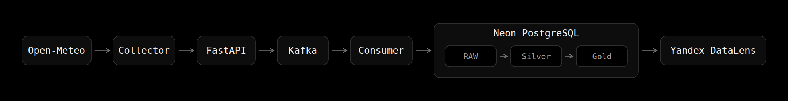
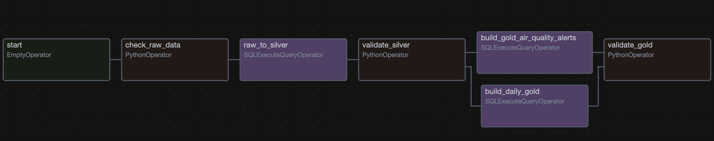
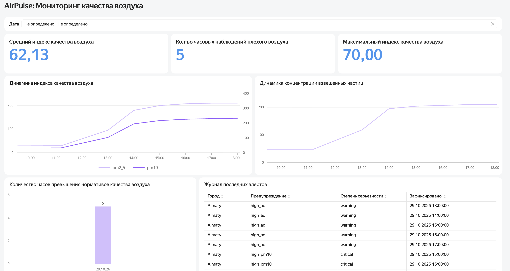

# AirPulse

AirPulse — учебный Data Engineering проект для сбора, обработки и анализа данных о качестве воздуха в Алматы.

Проект реализует полный pipeline: данные поступают из Open-Meteo Air Quality API, проходят через FastAPI и Apache Kafka, сохраняются в PostgreSQL, обрабатываются с помощью Apache Airflow и отображаются в Yandex DataLens.

## Цель проекта

Цель AirPulse — построить end-to-end pipeline обработки данных о качестве воздуха и на практике применить основные инструменты Data Engineering:

- Fast API;
- Apache Kafka;
- PostgreSQL;
- Apache Airflow;
- Docker;
- SQL;
- Python;
- Yandex DataLens.

Проект собирает показатели PM2.5, PM10, CO, NO2, SO2, O3 и European AQI для Алматы.

## Архитектура



Основной поток данных:

Open-Meteo → Collector → FastAPI → Kafka → Consumer → RAW → Silver → Gold → Yandex DataLens

Collector периодически получает данные из Open-Meteo Air Quality API.

FastAPI выполняет валидацию входящих данных и формирует событие.

Apache Kafka используется как брокер сообщений между ingestion API и consumer.

Consumer читает события Kafka и сохраняет их в RAW-слой PostgreSQL.

Apache Airflow запускает SQL-трансформации и проверки качества данных.

После обработки данные проходят через три слоя:

**RAW** — исходные Kafka events.

**Silver** — очищенные и типизированные наблюдения качества воздуха.

**Gold** — агрегированные показатели и алерты, используемые для аналитики.

## Data Layers

### RAW

Таблица:

`raw.kafka_events`

Содержит исходные Kafka events вместе с технической информацией:

- event_id;
- topic;
- partition;
- offset;
- event key;
- event type;
- source;
- ingestion timestamp;
- JSON payload.

Комбинация `(topic, partition, offset)` используется для защиты от повторной записи одного Kafka message.

### Silver

Таблица:

`silver.air_quality_observations`

JSON payload преобразуется в типизированные поля:

- city;
- latitude;
- longitude;
- observed_at;
- pm2_5;
- pm10;
- carbon_monoxide;
- nitrogen_dioxide;
- sulphur_dioxide;
- ozone;
- european_aqi.

Перед загрузкой Airflow выполняет проверки качества данных.

### Gold

Используются две основные таблицы:

`gold.daily_air_quality_stats`

Содержит агрегированные показатели качества воздуха.

`gold.air_quality_alerts`

Содержит события превышения установленных пороговых значений AQI, PM2.5 и PM10.

## Airflow Pipeline



DAG:

`air_quality_pipeline`

Pipeline выполняется автоматически по расписанию.

Основные этапы:

`check_raw_data → raw_to_silver → validate_silver → Gold transformations → validate_gold`

После проверки Silver параллельно выполняются:

- построение агрегатов качества воздуха;
- формирование алертов.

После этого выполняется финальная проверка Gold-слоя.

## Kafka

Основной topic:

`airquality.raw.v1`

Consumer использует manual offset commit.

Offset Kafka фиксируется только после успешной записи данных в PostgreSQL:

Kafka message → PostgreSQL INSERT → DB COMMIT → Kafka COMMIT

Такой подход обеспечивает модель обработки at-least-once.

## Dashboard



Для визуализации используется Yandex DataLens.

Dashboard показывает:

- средний AQI;
- максимальный AQI;
- количество наблюдений плохого качества воздуха;
- динамику PM2.5 и PM10;
- динамику индекса качества воздуха;
- количество превышений;
- журнал последних алертов.

## Запуск проекта

Создать `.env`:

```bash
cp .env.example .env
```

Добавить PostgreSQL/Neon connection string в:

```text
NEON_DATABASE_URL
```

Запустить инфраструктуру:

```bash
docker compose up -d --build
```

Проверить сервисы:

```bash
docker compose ps
```

Collector автоматически начинает получение данных.

Проверить его работу:

```bash
docker compose logs -f collector
```

Проверить consumer:

```bash
docker compose logs -f consumer
```

Проверить Airflow:

```text
http://localhost:8080
```

FastAPI Swagger:

```text
http://localhost:8000/docs
```

Kafka UI:

```text
http://localhost:8081
```

## Технологии

**Data ingestion:** Python, FastAPI

**Streaming:** Apache Kafka

**Database:** PostgreSQL / Neon PostgreSQL

**Orchestration:** Apache Airflow

**Transformation:** SQL, Python

**Infrastructure:** Docker

**Visualization:** Yandex DataLens

## Результат

AirPulse представляет собой работающий end-to-end Data Engineering pipeline, который автоматически получает данные о качестве воздуха, передаёт их через Kafka, сохраняет историю событий, выполняет трансформации RAW → Silver → Gold и предоставляет подготовленные данные для аналитического dashboard.
